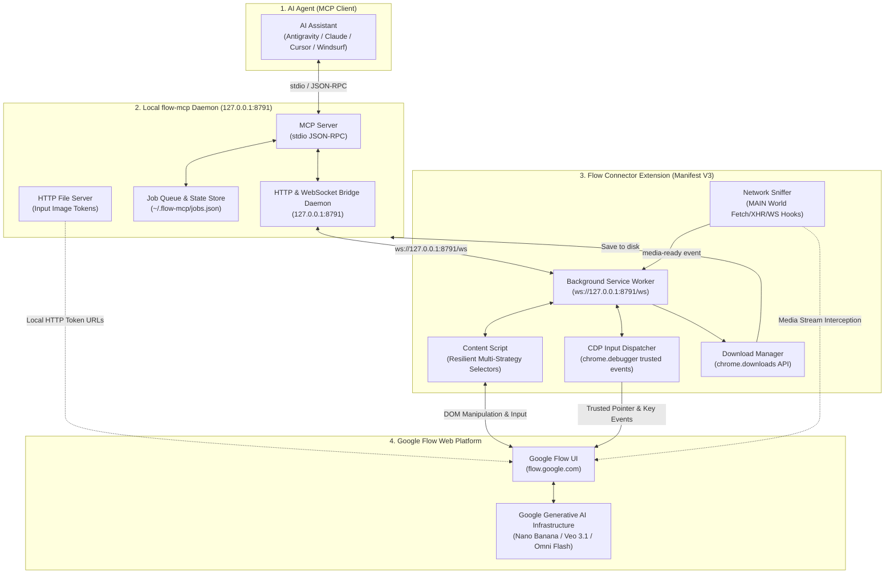
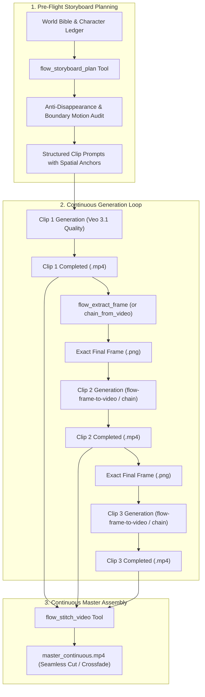

# Flow MCP (`flow-mcp`)

> **Model Context Protocol (MCP) Server & Automation Bridge for Google Flow**  
> Generate bulk images (Nano Banana Pro / 2 / Lite) and videos (Veo 3.1 Lite / Fast / Quality, Omni Flash) directly through your logged-in Google session.  
> **100% Free Forever — No Pricing, No Subscriptions, No Paywalls, No Daily Limits.**

---

## 🌟 Overview

`flow-mcp` is an open-source, production-ready Model Context Protocol (MCP) server, local bridge daemon, and CLI tool designed to connect AI coding agents (Claude Desktop, Cursor, Gemini, Codex, Windsurf, Antigravity) with **Google Flow** (`flow.google.com`).

By driving your logged-in browser session through trusted automation and network stream interception, `flow-mcp` allows agents to generate high-resolution images, video clips, extended scenes, and reusable characters with zero per-generation API costs.

---

## 🏗️ Architecture & System Design

`flow-mcp` is architected as a decoupled, four-tier automation bridge that connects AI coding assistants with Google Flow through your authenticated browser session.

### Architectural Diagram



---

### Layer-by-Layer Breakdown

#### 1. AI Agent Layer (MCP Client)
- **Protocol**: Standard Model Context Protocol (MCP) over `stdio` using JSON-RPC 2.0.
- **Client Support**: Fully compatible with Antigravity, Claude Desktop / Claude Code, Cursor, Windsurf, Codex, Gemini, and any other MCP-compliant host.
- **Tools Provided**: `flow_generate`, `flow_status`, `flow_get_job`, `flow_list_jobs`, `flow_retry_job`, `flow_cancel_job`, `flow_stop`, and `flow_doctor`.

#### 2. Local Bridge Daemon & State Machine (`src/bridge/` & `src/mcp/`)
- **MCP Server (`src/mcp/server.ts`)**: Exposes structured schemas (via Zod) for prompts, models, aspect ratios, durations, reference files, and project assets. Enforces model reference caps (e.g. up to 10 reference images for image-to-image; up to 7 for Omni Flash ingredients).
- **HTTP/WS Daemon (`src/bridge/server.ts`)**: Runs a persistent HTTP and WebSocket server on `127.0.0.1:8791`. Automatically started in-process by the MCP server or run standalone via `flow-mcp bridge`.
- **State Store (`src/bridge/state.ts`)**: Persists job history and execution states to `~/.flow-mcp/jobs.json`. Reclaims orphaned jobs across server restarts and manages timeouts (45s per MCP call budget).
- **Local File Server (`src/utils/files.ts`)**: When input reference images are supplied, registers them as ephemeral local tokens (`http://127.0.0.1:8791/files/:token/:filename`) with a 2-hour TTL, allowing the extension to upload local files directly into Google Flow without disk copying or cloud uploading.

#### 3. Browser Extension (`extension/` - Manifest V3)
- **Background Service Worker (`service-worker-loader.js` / `assets/index.ts-DUSFifLU.js`)**: Connects bidirectionally to `ws://127.0.0.1:8791/ws`, handles incoming `job.submit` commands, verifies tab visibility, tracks queue state, and manages extension lifecycle. Unlocked for unlimited generation and upscaling.
- **CDP Input Dispatcher (`chrome.debugger`)**: Attaches Chrome DevTools Protocol to the Flow tab to dispatch trusted, natural mouse (`Input.dispatchMouseEvent`) and keyboard interactions. This prevents the browser or web apps from blocking synthetic JavaScript events.
- **Resilient Content Script (`assets/index.ts--a0w5aTj.js`)**: Injected into `flow.google.com`. Features a multi-tiered fallback selector engine (CSS, ARIA labels, text content, and TestIDs) that dynamically finds prompt inputs, aspect ratio toggles, duration selectors, and generation buttons even if Google changes class names.
- **MAIN-World Network Sniffer (`assets/result-capture-flow.ts-Cu6ONkqg.js`)**: Injected at `document_start` into the page's `MAIN` execution context (`world: "MAIN"`). It wraps `window.fetch`, `XMLHttpRequest.prototype`, and `WebSocket` to intercept internal Google Flow responses (`flow-content.google`, `/media.getMediaUrlRedirect`) and file picker events without relying on fragile DOM scraping.
- **Download Automation (`chrome.downloads`)**: Automatically downloads finalized images (`.png`) and videos (`.mp4`) into the specified destination folder (defaulting to `Downloads/flow/`), supporting 2K image and 1080p video upscales.

#### 4. Google Flow (`flow.google.com`)
- The active web session where you are authenticated with your Google account.
- Directly invokes Google's frontier multimodal generation models:
  - **Images**: Nano Banana Pro, Nano Banana 2, Nano Banana 2 Lite.
  - **Videos**: Veo 3.1 Lite, Veo 3.1 Fast, Veo 3.1 Quality, and Omni Flash.

---

### Step-by-Step Execution Lifecycle

1. **Agent Invocation**: The AI agent calls `flow_generate` with a prompt, desired mode (e.g., `flow-text-to-video`), model (`veo-3.1-quality`), aspect ratio (`16:9`), and duration (`6s`).
2. **Registration & Queuing**: The MCP bridge assigns a unique UUID, maps any local reference images to token URLs, adds the job to `~/.flow-mcp/jobs.json`, and sends a `job.submit` WebSocket message to the browser extension.
3. **Tab Focus & DOM Setup**: The extension verifies the [flow.google.com](https://flow.google.com) tab is active, focuses the prompt box, types the prompt, selects the model, duration, and aspect ratio.
4. **Trusted Trigger**: The background service worker attaches `chrome.debugger` to fire authentic pointer down/up/click events on the Generate button.
5. **Stream Capture**: While Google processes the request, the injected `MAIN`-world network sniffer intercepts outgoing RPC requests and incoming media redirects (`flow-content.google`).
6. **Local Download**: As soon as media streams are ready, the extension downloads the media files to the user's local disk via `chrome.downloads`.
7. **Callback & Completion**: The extension sends a `job.result` message containing the local file paths back over the WebSocket bridge. The bridge updates the job record to `done` and the MCP tool returns the absolute file paths to the agent.

---

### Key Architectural Advantages

- **100% Free Forever**: Operates directly through your personal logged-in browser session; no paid API keys, credits, or third-party subscriptions required.
- **No Daily Generation Caps**: Unlocks bulk and continuous generation without artificial daily caps.
- **Zero-Trust Privacy**: Bridge communication is strictly confined to `127.0.0.1` loopback. No prompt data, tokens, or media ever touch third-party servers.
- **Anti-Detection & High Reliability**: Employs real Chrome DevTools Protocol (CDP) trusted input dispatching and network-level stream sniffing instead of brittle DOM scraping.

---

## 🚀 Step-by-Step Manual Installation

### 1. Build and Link CLI
```bash
# Clone the repository (if not already local)
git clone https://github.com/nirajan-khatiwada/GoogleFlowConnecterMcp.git
cd GoogleFlowConnecterMcp/flow-mcp

# Install dependencies and compile TypeScript
npm install
npm run build

# Link globally so 'flow-mcp' is available anywhere on your machine
npm link
```

### 2. Browser Extension Setup
1. Open your browser (`chrome://extensions` or `edge://extensions`).
2. Toggle on **Developer mode** in the top right.
3. Click **Load unpacked** and select the folder:
   `flow-mcp/extension` (or full path `c:\Users\Nirajan\Downloads\video\flow-mcp\extension`).
4. Open [https://flow.google.com](https://flow.google.com) and log in with your Google account.
5. Keep the Flow tab visible on your screen (side-by-side with your editor, not minimized).

### 3. Agent Configuration (MCP)
Add to your user-level MCP configuration (`~/.cursor/mcp.json`, `~/.claude.json`, `~/.gemini/config/mcp_config.json`, `~/.codeium/windsurf/mcp_config.json`, etc.):

```json
{
  "mcpServers": {
    "flow-connector": {
      "command": "flow-mcp"
    }
  }
}
```

*(Note: If `flow-mcp` is not in your system PATH, you can point directly to the built file):*
```json
{
  "mcpServers": {
    "flow-connector": {
      "command": "node",
      "args": ["c:/Users/Nirajan/Downloads/video/flow-mcp/dist/index.js"]
    }
  }
}
```

### 4. Installing the Agent Skill Manually (Recommended)

To make your AI agent significantly more effective at choosing the right model (`veo-3.1-quality` vs `nano-banana-pro`), camera movement prompts, aspect ratios, and reference image workflows, manually install the included `flow-generate` skill:

#### For Claude Code:
Create the destination folder and copy the skill file:
```bash
# Windows (PowerShell)
mkdir -Force "$env:USERPROFILE\.claude\skills\flow-generate"
cp skills/flow-generate/SKILL.md "$env:USERPROFILE\.claude\skills\flow-generate\SKILL.md"

# macOS / Linux (Bash)
mkdir -p ~/.claude/skills/flow-generate
cp skills/flow-generate/SKILL.md ~/.claude/skills/flow-generate/SKILL.md
```

#### For Antigravity / Gemini:
```bash
# Windows (PowerShell)
mkdir -Force "$env:USERPROFILE\.gemini\config\skills\flow-generate"
cp skills/flow-generate/SKILL.md "$env:USERPROFILE\.gemini\config\skills\flow-generate\SKILL.md"

# macOS / Linux (Bash)
mkdir -p ~/.gemini/config/skills/flow-generate
cp skills/flow-generate/SKILL.md ~/.gemini/config/skills/flow-generate/SKILL.md
```

#### For Cursor:
Copy `skills/flow-generate/SKILL.md` into your project's `.cursor/rules/flow-generate.mdc` or add to your global user rules.

#### For Windsurf / Cascade:
Copy or link `skills/flow-generate/SKILL.md` into your `.windsurfrules` or global memories.

---

## 🤖 One-Time Setup Prompt for AI Agents

This setup needs to be done once per machine. If using an AI agent (Claude Code, Cursor, Antigravity, Windsurf, Codex), you can simply paste this exact prompt:

```text
Set up Flow Connector on my machine so you can generate images and videos through my own logged-in Google Flow session (no API cost).

This is safe to run even if it's already set up — check each step first and skip anything already done. Never force or reinstall something that's already working.

1. Is the CLI already installed? Run:
     flow-mcp --version
   - If it prints a version, it's installed — SKIP to step 5.
   - If the command is not found, carry on with step 2.

2. Work out which machine this is, once, and use only that section from here on.
     WINDOWS   PowerShell / cmd, paths like C:\Users\...
     macOS     uname -s prints Darwin
     LINUX     uname -s prints Linux

3. Node.js 20 or newer. Run:
     node --version

4. Install/Link the Flow MCP CLI globally:
     npm install
     npm run build
     npm link
   This makes `flow-mcp` globally executable across all terminals.

5. Connect Flow MCP to Antigravity in your user-level MCP configuration (`~/.gemini/config/mcp_config.json`):
```json
{
  "mcpServers": {
    "flow-connector": {
      "command": "flow-mcp"
    }
  }
}
```

6. Install companion skills into your Antigravity skills directory (`~/.gemini/config/skills/`):
   - **`flow-generate`** (Bulk Image & Video Generation):  
     `~/.gemini/config/skills/flow-generate/SKILL.md`

7. Check the connection:
```bash
flow-mcp status
```
   - If extension is connected and flow tab is visible:
     "Connected! I can generate images and videos on Google Flow now — just ask."
   - If flow tab is HIDDEN: bring the Flow window to the front.

---

## 🧩 Available Plugins & Skills

- **Flow Generator (`flow-generate`)**
  - **Overview**: The core bulk media generation skill for Google Flow. Generates bulk images (Nano Banana Pro / 2 / Lite) and videos (Veo 3.1 Quality / Fast / Lite, Omni Flash) directly through your logged-in Google session.
  - 📖 **Details & Usage**: [skills/flow-generate/SKILL.md](skills/flow-generate/SKILL.md)

---

## 🎬 Multi-Clip Story, Scene & Character Continuity Engine

### The Problem in Video Diffusion Generation

Video diffusion models (Veo, Sora, Gen-2) generate each clip inside an isolated latent space without memory of previous clips. When generating a multi-clip sequence, this produces severe discontinuity:
1. **Character Appearance vs. Narrative Continuity**: While a character's face may look similar, their clothing, proportions, or demeanor fluctuate.
2. **The Disappearing Supporting Character Problem**: Supporting characters introduced in earlier scenes mysteriously vanish in subsequent clips because the prompt focused solely on the lead actor.
3. **Abrupt Boundary Jump-Cuts**: The starting frame of clip $N+1$ does not match the ending frame of clip $N$, resulting in discontinuous movements, reversed directions, teleported characters, and jarring scene resets.
4. **Spatial & Environmental Drift**: Furniture, lighting, room layout, and camera angles shift arbitrarily between cuts.

### The 5 Continuity Invariants

`flow-mcp` implements a five-tier continuity engine to solve this at the architecture and prompt layer:



#### Invariant 1: Pixel Boundary Frame Anchoring (`chain_from_video`)
Instead of generating clip $N+1$ from scratch, `flow-mcp` extracts the exact final frame of clip $N$ via FFmpeg and automatically injects it as the starting reference frame into Google Flow (`flow-frame-to-video`). This locks initial pixel layout, character coordinates, lighting, and environmental geometry.

#### Invariant 2: Character Ledger & Anti-Disappearance Rule
All participating characters are defined once in a **Character Ledger** with locked clothing, hair, height, and role. Every scene prompt must explicitly account for all active characters in the environment. Supporting characters **never disappear silently**—if a character leaves, an explicit narrative departure beat must occur on-screen.

#### Invariant 3: Action Inertia & Kinetic Momentum
Motions must carry through clip boundaries. If Clip 1 ends with a character reaching for a doorknob with their right hand, Clip 2 must open with that same hand turning the knob and opening the door, not standing with hands in pockets.

#### Invariant 4: Spatial Anchor Locks
Coordinates are locked across shots (e.g. `Character A at screen-left, Character B at screen-right near wooden table`). Camera angles, lighting direction, and landmark props are preserved until an explicit camera move is directed.

#### Invariant 5: Unified Multi-Clip Stitching (`flow_stitch_video`)
Once all sequential clips are generated, `flow_stitch_video` combines them using FFmpeg `concat` (direct lossless join) or `xfade` (subtle cinematic crossfade) into a single cohesive master MP4.

---

### Example: Continuous 3-Clip Production Workflow

#### Step 1: Validate Plan with `flow_storyboard_plan`
```typescript
call_mcp_tool({
  ServerName: "flow-connector",
  ToolName: "flow_storyboard_plan",
  Arguments: {
    title: "The Archive Discovery",
    world_bible: {
      visual_style: "Cinematic realistic 1080p, warm golden hour tungsten lighting, subtle dust motes",
      setting: "Victorian library archive with floor-to-ceiling mahogany shelves",
      lighting: "Soft directional sunlight from high arched windows",
      negative_constraints: "Strictly NO morphing limbs, no disappearing characters, no speech bubbles, no text"
    },
    character_ledger: [
      {
        id: "elena",
        name: "Elena (Historian)",
        appearance: "Mid-30s woman, dark hair in low bun, charcoal wool blazer, glasses",
        clothing_lock: "Charcoal wool blazer over ivory silk blouse, tortoiseshell glasses",
        default_spatial_anchor: "screen-center",
        relationship: "Lead investigator"
      },
      {
        id: "marcus",
        name: "Marcus (Archivist)",
        appearance: "Elderly gentleman, silver beard, tweed vest, rolled sleeves",
        clothing_lock: "Brown tweed vest over light blue collared shirt",
        default_spatial_anchor: "screen-right",
        relationship: "Archive custodian assisting Elena"
      }
    ],
    scene_beats: [
      {
        beat_number: 1,
        duration: "6",
        participating_characters: ["elena", "marcus"],
        action_narrative: "Elena and Marcus stand together at a large oak table examining a leather-bound folio. Marcus points to an illuminated diagram while Elena listens intently.",
        spatial_layout: "Elena at screen-center leaning forward; Marcus standing at screen-right pointing to folio.",
        camera_direction: "Slow dolly push-in toward the table",
        toNextClip: {
          exitCharacterPose: "Elena straightens up and points toward a high shelf on screen-left.",
          exitCameraState: "Medium two-shot locked on both characters.",
          exitActionOngoing: "Elena is pointing toward the upper bookshelf."
        }
      },
      {
        beat_number: 2,
        duration: "6",
        participating_characters: ["elena", "marcus"],
        fromPreviousClip: {
          entryCharacterPose: "Elena begins clip pointing at upper shelf; Marcus turns his head to look in that direction.",
          entryCameraState: "Medium two-shot matching previous final frame.",
          incomingMomentum: "Elena lowers her hand and moves toward the rolling library ladder."
        },
        action_narrative: "Elena walks toward the rolling ladder on screen-left, while Marcus remains at the oak table keeping watch over the documents.",
        spatial_layout: "Elena moves to screen-left ladder; Marcus remains grounded at screen-right table looking up at Elena.",
        camera_direction: "Pan slightly left following Elena while maintaining Marcus in frame.",
        toNextClip: {
          exitCharacterPose: "Elena climbs three steps up the rolling ladder, reaching her hand toward a red book.",
          exitCameraState: "Low angle looking up at Elena on ladder with Marcus visible at bottom-right.",
          exitActionOngoing: "Elena's hand is inches away from grasping the red spine."
        }
      },
      {
        beat_number: 3,
        duration: "6",
        participating_characters: ["elena", "marcus"],
        fromPreviousClip: {
          entryCharacterPose: "Elena on ladder reaching for red book; Marcus standing at base looking up.",
          entryCameraState: "Low angle two-shot matching previous final frame.",
          incomingMomentum: "Elena grasps the red book and pulls it from the shelf."
        },
        action_narrative: "Elena pulls the red book from the shelf, inspects its seal, and smiles down at Marcus who nods approvingly from the floor.",
        spatial_layout: "Elena elevated on ladder at screen-left; Marcus at ladder base on screen-right.",
        camera_direction: "Gentle tilt up focusing on Elena holding the book."
      }
    ]
  }
});
```

#### Step 2: Generate Clip 1
```typescript
call_mcp_tool({
  ServerName: "flow-connector",
  ToolName: "flow_generate",
  Arguments: {
    mode: "flow-text-to-video",
    prompt: "Cinematic Victorian archive. [0-3s] Elena (charcoal blazer, glasses) and Marcus (silver beard, tweed vest) examine an old folio on oak table. [3-6s] Marcus points at diagram; Elena straightens up and points toward upper shelf on screen-left. Both characters strictly in frame. Warm window light. NO MORPHING, NO TEXT.",
    image_model: "veo-3.1-quality",
    duration: "6"
  }
});
// Result: "/downloads/flow/archive_discovery_clip1.mp4"
```

#### Step 3: Generate Clip 2 (Chained from Clip 1)
```typescript
call_mcp_tool({
  ServerName: "flow-connector",
  ToolName: "flow_generate",
  Arguments: {
    chain_from_video: "/downloads/flow/archive_discovery_clip1.mp4",
    prompt: "Continuous action from anchor frame. Elena (charcoal blazer) lowers pointing hand and walks toward rolling library ladder on screen-left. Marcus (tweed vest) stays at oak table on screen-right watching her. Elena ascends three steps. Both characters stay in scene. Matching warm lighting. NO MORPHING.",
    image_model: "veo-3.1-quality",
    duration: "6"
  }
});
// Result: "/downloads/flow/archive_discovery_clip2.mp4"
```

#### Step 4: Generate Clip 3 (Chained from Clip 2)
```typescript
call_mcp_tool({
  ServerName: "flow-connector",
  ToolName: "flow_generate",
  Arguments: {
    chain_from_video: "/downloads/flow/archive_discovery_clip2.mp4",
    prompt: "Continuous action from anchor frame. Elena on ladder reaches and pulls red book from shelf. Marcus stands below looking up and nods approvingly. Elena smiles, opening the book. Both characters visible throughout. NO MORPHING.",
    image_model: "veo-3.1-quality",
    duration: "6"
  }
});
// Result: "/downloads/flow/archive_discovery_clip3.mp4"
```

#### Step 5: Stitch into Master Video with `flow_stitch_video`
```typescript
call_mcp_tool({
  ServerName: "flow-connector",
  ToolName: "flow_stitch_video",
  Arguments: {
    clip_paths: [
      "/downloads/flow/archive_discovery_clip1.mp4",
      "/downloads/flow/archive_discovery_clip2.mp4",
      "/downloads/flow/archive_discovery_clip3.mp4"
    ],
    transition: "cut",
    output_path: "/downloads/flow/archive_discovery_master.mp4"
  }
});
// Result: Seamless 18-second continuous narrative video!
```

---

---

## 🎯 Curated Zero-Mess Prompts (Veo 3.1 · Nano Banana Pro · Omni Flash)

Diffusion video and image models can generate messy artifacts (morphing limbs, blurry textures, hallucinated text, and unwanted speech bubbles) if prompts lack strict negative constraints and concrete physical anchors.

Use these curated, battle-tested prompt designs for **Veo 3.1**, **Nano Banana Pro**, and **Omni Flash** to guarantee clean, professional, broadcast-grade output every single time.

### 1. 🎬 Veo 3.1 Quality (`veo-3.1-quality`) — Text-to-Video
> **Best For**: 1080p cinematic video clips (4s, 6s, 8s, 10s), fluid physics, natural lighting, and sweeping camera tracking with zero input images.

#### The Anti-Mess Prompt Architecture:
```text
[SPEC]: 6-second video, 16:9 widescreen, 1080p, 24fps, fluid cinematic motion physics.
[ENVIRONMENT]: High-key modern white studio with subtle light-gray perspective floor grid. Clean negative space, zero background clutter, zero random gradients.
[CHARACTER ANCHOR]: A confident tech innovator in a minimalist navy jacket and dark denim. Proportions and features remain strictly consistent throughout the scene.
[TIMED BEATS]:
- [0-2s]: The character walks briskly from screen-left into center frame, looking forward with confident posture.
- [2-4s]: The character halts, turns slightly towards the camera, and taps a floating cyan holographic interface card that expands smoothly.
- [4-6s]: The character gives an enthusiastic presentation gesture, smiling confidently as the camera pushes in slightly.
[CAMERA]: Smooth lateral tracking shot moving left-to-right at constant medium velocity, keeping the character centered.
[AUDIO & DIALOGUE LOCK]: Audio voiceover only, strictly no speech bubbles, no dialogue text boxes. Narration: "Stop building features nobody asked for."
[NEGATIVE CONSTRAINTS]: Strictly NO on-screen text, no speech bubbles, no dialogue boxes, no morphing limbs, no melting hands, no extra fingers, no pixelated artifacts, no watermark.
```

#### Example Flow MCP Tool Call:
```typescript
call_mcp_tool({
  ServerName: "flow-connector",
  ToolName: "flow_generate",
  Arguments: {
    mode: "flow-text-to-video",
    prompt: "Cinematic 2D/3D character in navy jacket walking across clean pure-white modern studio with faint floor perspective grid. [0-2s] Walks from left to center. [2-4s] Taps floating glowing cyan holographic card. [4-6s] Gives an energetic presentation gesture to camera. Smooth lateral tracking camera. Audio voiceover only, strictly no speech bubbles: 'Stop building features nobody asked for.' Upbeat modern synthesizer. STRICTLY NO ON-SCREEN TEXT, NO SPEECH BUBBLES, NO MORPHING LIMBS.",
    image_model: "veo-3.1-quality",
    aspect_ratio: "16:9",
    duration: "6",
    outputs: 1
  }
});
```

---

### 2. ⚡ Veo 3.1 Fast (`veo-3.1-fast`) — Dynamic Image/Frame-to-Video
> **Best For**: High-speed action, rapid motion iteration, camera zooms, and frame-locked clips using up to 3 starting reference images.

#### The Anti-Mess Prompt Architecture:
```text
[SPEC]: 6-second video, 16:9 widescreen, fast dynamic pacing, 24fps.
[FRAME LOCK]: Start exactly from the character pose in Reference 1. Maintain identical line weight, proportions, and clothing colors.
[KINETIC ACTION]:
- [0-2s]: From the locked starting pose, the character sprints rapidly towards screen-right across a dark cinematic studio floor.
- [2-4s]: The character leaps cleanly over a glowing neon red obstacle line, landing in a heroic three-point stance.
- [4-6s]: The character stands up, dusts off hands, and glances back with an expressive confident smile.
[CAMERA]: High-speed dynamic tracking camera matching the character's sprint velocity with cinematic motion blur on the background only.
[NEGATIVE CONSTRAINTS]: Strictly no character morphing, no extra legs, no distorted torso, no speech bubbles, no text captions in video frame, no watermark.
```

---

### 3. 🍌 Nano Banana Pro (`nano-banana-pro`) — Text/Image-to-Image
> **Best For**: High-resolution character model turnaround sheets (front/side/back), vector-clean scene illustrations, and standalone asset generation.

#### The Anti-Mess Character Turnaround Sheet Formula:
```text
Model character turnaround sheet of an animated character. Three full-body poses side-by-side on a single horizontal row: front view, three-quarter view, and side profile view. 
Design: Clean expressive character with distinct silhouette, wearing a modern navy jacket and white sneakers. Uniform proportions across all views.
Canvas: Digitally pure solid white background (#FFFFFF), zero gradients, zero shadows, zero paper texture, zero noise. Clean vector line art, crisp silhouette, suitable for sprite extraction.
Negative constraints: No realistic photo skin, no gradients, no shadows, no color bleed, no text, no labels, no watermark.
```

#### The Anti-Mess Scene Prop Formula:
```text
Minimalist black ink line drawing on pure solid white background (#FFFFFF). Hand-drawn sketch of an antique brass balance scale with two weighing pans. Organic pen line art with selective warm golden accent marker. Flat 2D vector graphic, crisp clean edges, zero drop shadows, zero gradients, zero background elements, zero text.
```

---

### 4. 🔮 Omni Flash (`omni-flash`) — Multi-Ingredient Video
> **Best For**: Locking character face, outfit, and prop likeness across multiple scenes by attaching up to 7 reference images.

#### The Anti-Mess Prompt Architecture:
```text
[SPEC]: 6-second video, 16:9 widescreen, 1080p, 24fps.
[INGREDIENT MAPPING]:
- Character: Use the exact character from Reference 1 (navy jacket, proportions). Do NOT alter facial style or clothing.
- Prop: Feature the antique balance scale from Reference 2 on the wooden table.
[ACTION BEATS]:
- [0-3s]: The character from Reference 1 leans over the table, carefully placing objects into the balance scale from Reference 2.
- [3-6s]: The scale balances evenly; the character smiles with satisfaction and looks up towards the viewer.
[ENVIRONMENT]: Warm minimalist studio with soft daylight illumination.
[AUDIO & DIALOGUE LOCK]: Audio voiceover only, strictly no speech bubbles: "A fair trade built on trust."
[NEGATIVE CONSTRAINTS]: Strictly lock likeness to Reference 1, no costume changes, no facial distortion, no extra limbs, strictly no on-screen text, no speech bubbles, no watermark.
```

#### Example Flow MCP Tool Call:
```typescript
call_mcp_tool({
  ServerName: "flow-connector",
  ToolName: "flow_generate",
  Arguments: {
    mode: "flow-ingredients-to-video",
    prompt: "The character from Reference 1 interacts with the balance scale from Reference 2. [0-3s] Places items into scale. [3-6s] Scale balances evenly, character smiles. Exact likeness to Reference 1, no costume changes. Audio voiceover only, strictly no speech bubbles: 'A fair trade built on trust.' STRICTLY NO ON-SCREEN TEXT.",
    image_paths: [
      "c:/projects/my-video/assets/character_sheet.png",
      "c:/projects/my-video/assets/balance_scale.png"
    ],
    image_model: "omni-flash",
    aspect_ratio: "16:9",
    duration: "6"
  }
});
```

---

## 🛠️ MCP Tools Reference

`flow-mcp` registers the following standard tools:

### `flow_generate`
Generates images or videos with Google Flow.

| Argument | Type | Default | Description |
| :--- | :--- | :--- | :--- |
| `prompt` | `string` | *(Required)* | Prompt describing the desired generation |
| `mode` | `enum` | `flow-text-to-image` | `flow-text-to-image`, `flow-image-to-image`, `flow-text-to-video`, `flow-frame-to-video`, `flow-ingredients-to-video`, `flow-video-to-video`, `flow-extend-video`, `flow-create-character`, `flow-set-voice` |
| `image_paths` | `string[]` | `[]` | Absolute file paths to reference images on disk |
| `aspect_ratio` | `enum` | `16:9` | `16:9`, `9:16`, `1:1`, `2:3`, `3:2`, `4:3`, `3:4` |
| `duration` | `enum` | `6` | Video length: `4`, `6`, `8`, `10` seconds |
| `image_model` | `enum` | auto | Images: `nano-banana-pro`, `nano-banana-2`, `nano-banana-2-lite`<br>Videos: `omni-flash`, `veo-3.1-lite`, `veo-3.1-fast`, `veo-3.1-quality` |
| `outputs` | `number` | `1` | Variations per prompt (1 to 4) |
| `folder` | `string` | `flow` | Subfolder under your Downloads directory |
| `new_project` | `boolean` | `false` | Start generation in a brand new Flow project |
| `character_name` | `string` | optional | Name of character to create or reference |
| `character_refs`| `string[]` | optional | Cast reusable project characters in this scene |
| `asset_refs` | `string[]` | optional | Reuse existing project assets as ingredients |
| `chain_from_video` | `string` | optional | Path to previous video clip. Automatically extracts final frame and switches mode to `flow-frame-to-video` for seamless boundary continuity |
| `wait` | `boolean` | `true` | Wait for completion (up to 45s) before returning |

### `flow_storyboard_plan`
Pre-flight validator and prompt architect for multi-clip generation. Audits character presence, enforces the anti-disappearance invariant, verifies boundary momentum handoffs, and generates structured, zero-drift prompts for each clip.

| Argument | Type | Default | Description |
| :--- | :--- | :--- | :--- |
| `title` | `string` | *(Required)* | Project or narrative title |
| `world_bible` | `object` | *(Required)* | Environment specification: visual style, setting, lighting, physics, audio atmosphere |
| `character_ledger` | `array` | *(Required)* | List of all characters (id, name, appearance, clothing lock, default spatial anchor, relationship) |
| `scene_beats` | `array` | *(Required)* | Chronological beats with duration, participating characters, actions, spatial layout, boundary handoffs (`fromPreviousClip`, `toNextClip`) |

### `flow_extract_frame`
Extracts an exact high-resolution anchor frame from a video clip using FFmpeg for visual continuity anchoring.

| Argument | Type | Default | Description |
| :--- | :--- | :--- | :--- |
| `video_path` | `string` | *(Required)* | Absolute path to the source video file |
| `position` | `enum` | `last` | Frame position to extract: `last`, `first`, or `timestamp` |
| `timestamp_seconds` | `number` | optional | Exact timestamp in seconds (when position is `timestamp`) |
| `output_path` | `string` | optional | Custom output path for the extracted PNG image |

### `flow_stitch_video`
Stitches multiple sequential video clips into a single continuous master video using direct seamless cut or cinematic crossfade.

| Argument | Type | Default | Description |
| :--- | :--- | :--- | :--- |
| `clip_paths` | `string[]` | *(Required)* | Chronological list of clip video paths (minimum 2 clips) |
| `output_path` | `string` | optional | Custom output path for master continuous video |
| `transition` | `enum` | `cut` | Transition type: `cut` (seamless direct join) or `crossfade` (blended transition) |
| `crossfade_duration` | `number` | `0.5` | Crossfade duration in seconds (if transition is `crossfade`) |

### `flow_status`
Reports live status of the bridge daemon, browser extension, Google sign-in state, tab visibility, and active jobs.

### `flow_get_job`
Polls or waits for a running job by its `job_id`. Returns local paths of downloaded media upon completion.

### `flow_list_jobs`
Lists recent generation jobs, prompts, statuses, retry attempts, and file locations.

### `flow_retry_job`
Retries a failed or cancelled generation job (via `job_id`), or batch-retries all failed jobs (`retry_all: true`). Preserves all uploaded input images and tokens, re-queues them into the active bridge dispatcher, and optionally waits for completion.

### `flow_cancel_job`
Cancels a specific pending or running job.

### `flow_stop`
Emergency stop: immediately halts queue and cancels all pending/running jobs.

### `flow_doctor`
Performs end-to-end diagnostic checks on Node, port 8791, extension connection, and Google tab readiness.

---

## 💻 CLI Commands

You can also use `flow-mcp` directly from your command line:

```bash
# Check status of extension connection
flow-mcp status

# Run system diagnostics
flow-mcp doctor

# Generate an image from prompt
flow-mcp generate "Cyberpunk samurai standing in rain at dusk, neon reflections" --aspect-ratio 16:9

# Generate a video with Veo
flow-mcp generate "Hyperlapse of clouds passing over snowcapped mountains" --mode flow-text-to-video --duration 6

# Chain from previous clip to maintain seamless boundary continuity (auto-extracts last frame)
flow-mcp generate "Character enters the archive room and examines documents" --chain "./downloads/clip_1.mp4" --duration 6

# Extract anchor frame from video (last, first, or timestamp)
flow-mcp extract-frame "./downloads/clip_1.mp4" --position last --output "./anchors/clip1_end.png"

# Stitch sequential clips into a master continuous video (cut or crossfade)
flow-mcp stitch ./downloads/clip_1.mp4 ./downloads/clip_2.mp4 ./downloads/clip_3.mp4 --transition cut --output "./master_film.mp4"

# List recent jobs (with attempt counts)
flow-mcp list

# Retry a specific failed job
flow-mcp retry <job-id>

# Retry all failed jobs in queue
flow-mcp retry --all

# Stop all active generation
flow-mcp stop
```

---

## 📋 Generation Modes

- **`flow-text-to-image`**: Fast text-to-image with Nano Banana Pro/2/Lite.
- **`flow-image-to-image`**: Image-guided generation taking up to 10 input reference images.
- **`flow-text-to-video`**: Text-to-video with Veo 3.1 and Omni Flash.
- **`flow-frame-to-video`**: First and last frame video interpolation (2 reference frames).
- **`flow-ingredients-to-video`**: Multi-asset video composition (up to 7 references).
- **`flow-video-to-video`**: Video stylization and transformation.
- **`flow-extend-video`**: Lengthen an existing Veo clip (+6s per extension).
- **`flow-create-character`**: Generates and registers a consistent character into the project.

---

## 🔒 Security & Privacy

- All bridge traffic is bound exclusively to `127.0.0.1:8791`.
- Input image tokens expire after 2 hours and are served only to local loopback.
- No personal data, session tokens, or API keys are ever transmitted externally.
