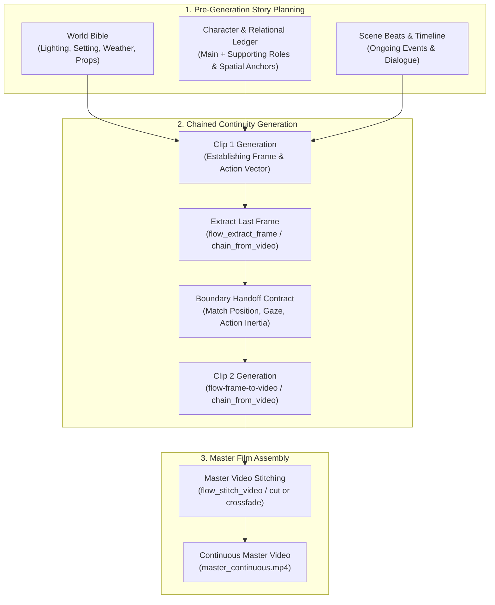

# Flow Generate Skill & Multi-Clip Continuity Engine

This skill guides AI coding agents to produce high-resolution imagery and **continuous multi-clip cinematic video stories** through **Google Flow** using the local `flow-mcp` automation bridge.

---

## 🎯 When to Use This Skill

Activate this skill when the user asks to:
- Generate continuous, multi-clip narrative video sequences where characters, environments, and storylines flow seamlessly without abrupt cuts.
- Establish a complete story storyboard, character roster, and scene continuity plan before generating video clips.
- Generate cinematic video clips, camera motion shots, animated scenes, or b-roll footage.
- Animate a static image into a video (frame-to-video) or chain the end of one clip into the start of the next clip (`chain_from_video`).
- Create consistent character designs and maintain their appearance, roles, and interactions across multiple scenes.
- Stitch multiple sequential video clips into a single continuous master video (`master_continuous.mp4`).
- Extend existing video clips to build longer story sequences (`flow-extend-video`).

---

## ⚙️ Prerequisites & Operational Rules

1. **Active Bridge**: The `flow-mcp` bridge daemon must be running (listens on `127.0.0.1:8791`).
2. **Open & Logged-In Flow Tab**: The user must have [https://flow.google.com](https://flow.google.com) open and logged into their Google account in Chrome or Edge with the Flow Connector extension enabled.
3. **Tab Visibility**: The Flow tab must be **visible on screen** (side-by-side or on a secondary display). Chromium throttles background tabs, which stalls generation if minimized.
4. **Verify First**: Call `flow_status` or `flow_doctor` before firing multi-clip video batches.

---

## 🎬 MASTER MULTI-CLIP CONTINUITY PROTOCOL

### The Problem in Video Diffusion
Video diffusion models generate each clip in isolation. If multiple clips are submitted as independent text prompts:
- Characters may share visual likeness, but their **poses, actions, and physical momentum reset** at the start of each clip.
- **Supporting characters vanish**: A companion introduced in Clip 1 disappears in Clip 2 because the prompt focused solely on the lead.
- **Spatial jumping & teleportation**: A character on the left suddenly appears on the right; room layouts, lighting directions, and windows randomly drift.
- **Abrupt boundary cuts**: Clip 1 ends mid-motion, and Clip 2 starts with a static or conflicting action.

To create videos that feel like **one continuous, coherent, professional film**, you MUST adhere to the **5 Core Continuity Invariants**.

---

### The 5 Core Continuity Invariants



#### 1. The World Bible & Static Invariant Rule
Before generating clip 1, define the physical environment and lock it across all connected clips:
- **Architecture & Layout**: If the room has a floor-to-ceiling window on screen-left and a mahogany workbench in center-frame, this layout MUST remain identical in all clips within that scene.
- **Lighting Direction Lock**: Identify the primary light source and lock its angle and quality (e.g. *"Warm golden-hour sunlight streaming from screen-left at a 30° angle, casting long soft shadows towards screen-right"*). Never switch to diffuse or overhead light without narrative motivation.
- **Atmospheric Palette**: Lock weather, color temperature, and airborne particles (e.g. *"Subtle dust motes drifting in sunbeams, deep teal and amber color grade"*).

#### 2. The Character Ledger & Anti-Disappearance Invariant
Characters are more than a visual prompt description—they have active spatial positions, narrative roles, and ongoing relationships:
- **Supporting Characters MUST NOT Disappear**: If a supporting character (e.g. mentor, assistant, partner, droid) is present in Clip 1, they MUST remain present and actively involved in subsequent clips in the same scene.
- **Explicit Exit Rule**: A character may only disappear from a scene if an **explicit on-screen exit beat** is depicted (e.g. *"Character B turns and walks out through the doorway at screen-right [4-6s]"*). If no exit beat occurred, they are still in the room!
- **Multi-Character Spatial Anchoring**: Assign and maintain screen coordinates:
  - *Character A (Lead)*: Screen-left (facing 45° towards screen-right).
  - *Character B (Supporting)*: Screen-right (facing 45° towards screen-left).
  - Do not flip their positions unless an on-camera crossover movement is animated.

#### 3. Spatial Coordinate & Eyeline Locking
- **Eyeline Match**: Characters talking or interacting with each other must maintain consistent gaze vectors across clip boundaries.
- **Scale and Proportions**: Relative heights and body proportions between characters must remain strictly locked.

#### 4. Action Inertia & Boundary Handoff Contract
The ending of Clip $N$ must serve as the natural, physical starting point for Clip $N+1$:
- **Ending Frame Vector ($t = \text{end}$ of Clip $N$)**:
  - Exact body pose, limb position, and head angle.
  - Hand placement (e.g. *"Right hand reaching forward holding the glowing cylinder"*).
  - Velocity and direction of motion (e.g. *"Mid-stride moving screen-left to screen-right at medium walking speed"*).
  - Camera angle, distance, and focal direction.
- **Opening Frame Vector ($t = 0\text{s}$ of Clip $N+1$)**:
  - MUST match the ending frame vector of Clip $N$.
  - Continue the motion naturally across the clip boundary without restarting, pausing, or snapping back to a neutral stance.

#### 5. Technical Frame-Chaining Pipeline (`chain_from_video`)
Diffusion models will drift if prompted with pure text for Clip 2. To lock the physical boundary:
- **Automated Chaining**: When calling `flow_generate` for Clip 2, pass `chain_from_video: "<path_to_clip1.mp4>"`.
- `flow-mcp` automatically extracts the exact final frame of Clip 1 and passes it to Google Flow as the **Starting Frame** (`flow-frame-to-video` / ingredients mode).
- This ensures the pixel state at $t=0\text{s}$ of Clip 2 matches $t=\text{end}$ of Clip 1.

---

## 🛠️ Step-by-Step Multi-Clip Production Workflow

### Step 1: Pre-Flight Storyboard Planning (`flow_storyboard_plan`)
Call `flow_storyboard_plan` to define your World Bible, Character Roster, and Scene Continuity Beats.

```typescript
call_mcp_tool({
  ServerName: "flow-connector",
  ToolName: "flow_storyboard_plan",
  Arguments: {
    title: "The Alchemist's Discovery",
    logline: "In a sunlit renaissance workshop, Master Alchemist Julian and his eager apprentice Lea activate an ancient brass automaton that awakens for the first time.",
    world_bible: {
      setting: "Renaissance stone alchemical laboratory with tall arched leaded-glass windows on screen-left, cluttered wooden workbenches filled with glass alembics and parchment rolls.",
      time_period: "Late afternoon golden hour",
      visual_tone: "Warm cinematic 35mm film still, rich amber and emerald palette, shallow depth of field, subtle airborne dust motes",
      lighting_rules: "Direct warm sunlight streaming through arched windows on screen-left, illuminating characters from side-left, deep warm shadows on screen-right",
      invariants: [
        "Master Julian always wears deep navy velvet coat with embroidered lapels and stays screen-left",
        "Apprentice Lea always wears dark teal apron over cream linen blouse and stays screen-right",
        "The brass automaton sits centrally on the workbench between both characters",
        "Supporting character Lea must remain in the scene and visibly react in every clip"
      ]
    },
    characters: [
      {
        name: "Master Julian",
        role: "Lead Master Alchemist, cautious and methodical",
        appearance: "Distinguished man in his late 50s, neatly trimmed silver beard, deep navy velvet coat, silver spectacles perched on nose",
        spatial_anchor: "Screen-left",
        clothing_lock: "Navy velvet coat with brass buttons over dark waistcoat"
      },
      {
        name: "Apprentice Lea",
        role: "Supporting Apprentice, observant, curious and supportive",
        appearance: "Young woman in her early 20s, dark auburn hair tied in a loose braid, dark teal leather apron over cream linen blouse",
        spatial_anchor: "Screen-right",
        clothing_lock: "Dark teal artisan apron with tool pouches over cream linen shirt"
      }
    ],
    scenes: [
      {
        clip_number: 1,
        scene_title: "Inspecting the Automaton Core",
        duration: "6",
        environment: {
          location: "Renaissance workshop workbench",
          lighting: "Warm golden sunlight from screen-left windows",
          key_objects: ["Intricate brass mechanical automaton", "Glowing amber crystal", "Parchment diagrams"]
        },
        characters_present: [
          {
            name: "Master Julian",
            position: "Screen-left",
            action: "Carefully lowers a glowing amber crystal into the automaton chest cavity using brass tweezers",
            gaze_or_expression: "Intense concentration, brow furrowed"
          },
          {
            name: "Apprentice Lea",
            position: "Screen-right",
            action: "Leans forward over the table, holding an oil lamp steady and watching with rapt attention",
            gaze_or_expression: "Awe and anticipation, eyes wide"
          }
        ],
        ongoing_events: "Julian places the power crystal into the automaton core while Lea illuminates the delicate gears.",
        camera_movement: "Slow medium push-in tracking towards the workbench",
        continuity_handoff: {
          to_next_clip: "Crystal locks into the chest socket with a faint pulse of light; Julian's hand rests on the tweezers, Lea leans forward with parted lips"
        }
      },
      {
        clip_number: 2,
        scene_title: "The Automaton Awakens",
        duration: "6",
        environment: {
          location: "Renaissance workshop workbench",
          lighting: "Golden sunlight from screen-left enhanced by amber glow emanating from automaton chest",
          key_objects: ["Brass automaton with glowing chest", "Workbench instruments"]
        },
        characters_present: [
          {
            name: "Master Julian",
            position: "Screen-left",
            action: "Slowly draws his hands back from the automaton, raising a palm in caution",
            gaze_or_expression: "Astonished pride giving way to vigilant wonder"
          },
          {
            name: "Apprentice Lea",
            position: "Screen-right",
            action: "Steps back half a step while keeping both hands on the table edge, smiling in amazement",
            gaze_or_expression: "Pure joy and disbelief, glancing between the robot and Julian"
          }
        ],
        ongoing_events: "Internal gears spin with whirring clicks; the automaton's optical lenses adjust and its head tilts up towards Julian.",
        camera_movement: "Gentle lateral track right-to-left maintaining both characters in two-shot profile",
        continuity_handoff: {
          from_previous_clip: "Starts exactly from Julian's hand releasing the tweezers as the crystal begins glowing",
          to_next_clip: "Automaton lifts its articulated brass hand towards Julian; Julian extends a finger in greeting while Lea watches admiringly"
        }
      }
    ]
  }
});
```

---

### Step 2: Generate Clip 1 (Master Establishing Action)
Generate Clip 1 using `flow-text-to-video` (or `flow-frame-to-video` if starting from a concept art still):

```typescript
call_mcp_tool({
  ServerName: "flow-connector",
  ToolName: "flow_generate",
  Arguments: {
    mode: "flow-text-to-video",
    prompt: "[SCENE 1: INSPECTING THE AUTOMATON CORE]\n[ENVIRONMENT]: Renaissance stone workshop with tall arched windows screen-left. Warm golden hour sunlight streaming at 30 degrees, amber tones, soft floating dust motes.\n[CHARACTERS & SPATIAL POSITIONS]:\n- Master Julian: Positioned Screen-Left. Late 50s, silver beard, navy velvet coat, silver spectacles. Using brass tweezers to lower glowing amber crystal into brass automaton chest.\n- Apprentice Lea: Positioned Screen-Right. Early 20s, auburn braid, dark teal apron over cream blouse. Leaning forward over workbench holding oil lamp, watching with rapt attention.\n[TIMED BEATS]:\n- [0-3s]: Julian carefully aligns the crystal into the chest socket as Lea leans in closer.\n- [3-6s]: Crystal clicks home; subtle amber pulse illuminates both faces. Julian holds tweezers steady, Lea parts lips in quiet awe.\n[CAMERA]: Slow cinematic push-in towards the workbench, keeping both characters framed in medium two-shot.\n[ENDING FRAME VECTOR]: Julian's right hand holding tweezers at automaton chest; Lea leaning forward with hands on table edge.\n[NEGATIVE GUARDS]: Strictly NO character disappearing, Lea must remain screen-right throughout, NO modern clothing, NO speech bubbles, NO text overlays.",
    image_model: "veo-3.1-quality",
    aspect_ratio: "16:9",
    duration: "6"
  }
});
```

---

### Step 3: Chain Into Clip 2 with `chain_from_video`
When Clip 1 downloads (e.g. `Downloads/flow/alchemist_clip1.mp4`), generate Clip 2 by passing `chain_from_video: "Downloads/flow/alchemist_clip1.mp4"`.

`flow-mcp` automatically extracts the exact last frame of Clip 1 and feeds it as the anchor frame!

```typescript
call_mcp_tool({
  ServerName: "flow-connector",
  ToolName: "flow_generate",
  Arguments: {
    mode: "flow-frame-to-video",
    chain_from_video: "C:/Users/Nirajan/Downloads/flow/alchemist_clip1.mp4",
    prompt: "[SCENE 2: THE AUTOMATON AWAKENS]\n[ENVIRONMENT]: Renaissance workshop. Identical arched windows screen-left, warm golden sunlight supplemented by glowing amber core.\n[CHARACTERS & SPATIAL POSITIONS]:\n- Master Julian: Positioned Screen-Left. Navy velvet coat. Slowly retracts hands from automaton chest, stepping back half a pace.\n- Apprentice Lea: Positioned Screen-Right. Dark teal apron. Remains on screen-right, smiling in astonishment as gears whirl.\n[ACTION CONTINUATION FROM PREVIOUS FRAME]: Starting exactly from Julian holding tweezers at automaton chest and Lea leaning forward on table. Julian draws hands back smoothly, gears inside automaton begin spinning.\n[TIMED BEATS]:\n- [0-3s]: The automaton lenses click and whir; Julian steps back half a pace with hands raised cautiously. Lea smiles warmly.\n- [3-6s]: The automaton head tilts up, its brass hand raises towards Julian. Julian smiles with proud wonder, Lea watches with delight.\n[CAMERA]: Smooth lateral tracking shot keeping Julian on left, automaton in center, and Lea on right.\n[NEGATIVE GUARDS]: Strictly NO character disappearance, Lea must remain visible on screen-right, NO character morphing, NO text overlays.",
    image_model: "veo-3.1-fast",
    aspect_ratio: "16:9",
    duration: "6"
  }
});
```

---

### Step 4: Stitch All Clips into Master Video (`flow_stitch_video`)
Once all sequential clips are generated, stitch them into a continuous film:

```typescript
call_mcp_tool({
  ServerName: "flow-connector",
  ToolName: "flow_stitch_video",
  Arguments: {
    clip_paths: [
      "C:/Users/Nirajan/Downloads/flow/alchemist_clip1.mp4",
      "C:/Users/Nirajan/Downloads/flow/alchemist_clip2.mp4",
      "C:/Users/Nirajan/Downloads/flow/alchemist_clip3.mp4"
    ],
    output_path: "C:/Users/Nirajan/Downloads/flow/alchemist_master_film.mp4",
    transition: "cut"
  }
});
```

---

## 📋 Comprehensive Model Selection Matrix

| Model | Input References | Continuity Strengths | Ideal Continuity Use Case |
| :--- | :--- | :--- | :--- |
| `veo-3.1-quality` | 0 references | Highest photorealism, fluid physics, natural lighting | Establishing shots, opening scenes (Clip 1) |
| `veo-3.1-fast` | Up to 3 references | High-speed rendering with exact frame anchoring | Sequential chained clips (Clip 2, 3...) using `chain_from_video` |
| `omni-flash` | Up to 7 references | Multi-ingredient asset blending | Complex scenes combining previous frame + character likeness + props |
| `nano-banana-pro` | Up to 10 references | Vector-crisp character design | Character model turnaround sheets (front/side/back) |

---

## 🎨 Zero-Drift Prompt Engineering Template

Every prompt in a multi-clip sequence MUST follow this standardized structure:

```text
[SCENE N: TITLE]
[ENVIRONMENT & LIGHTING LOCK]: Exact physical room/landscape, time of day, key light source angle, shadow quality.
[CHARACTERS & SPATIAL ANCHORS]:
- Character 1 (Role): Screen position, clothing lock, physical action, gaze direction.
- Character 2 (Role): Screen position, clothing lock, physical action, gaze direction.
[ACTION CONTINUATION FROM PREVIOUS FRAME]: (For Clips 2+) Exact motion inertia picked up from the final millisecond of previous clip.
[TIMED BEATS]:
- [0-2s]: Action initiation / continuation.
- [2-4s]: Peak interaction / event development.
- [4-6s]: Transition setup / ending pose.
[CAMERA]: Lens focal length, camera motion path and velocity.
[ENDING FRAME VECTOR]: Exact body posture and object state passed to next clip.
[NEGATIVE CONTINUITY GUARDS]: Strictly NO character disappearance, NO character teleporting, NO costume drift, NO morphing hands, NO on-screen text, NO speech bubbles.
```

---

## 💡 Quality Audit Checklist for Multi-Clip Continuity

Before declaring a video sequence complete, verify:
- [ ] **Did any character disappear?** Confirm all characters present in earlier clips remain present in subsequent clips unless an explicit exit was depicted.
- [ ] **Do character positions match?** If Character A is screen-left in Clip 1, they must not appear on screen-right in Clip 2 without walking across.
- [ ] **Does action momentum continue?** If a character is running forward at the end of Clip 1, they must be running forward at the start of Clip 2.
- [ ] **Is the lighting angle identical?** Sunbeams or indoor key lights must maintain consistent shadow angles across all clips.
- [ ] **Was `chain_from_video` used?** Verify that Clip 2 and Clip 3 anchored from the exact final frame of their predecessor.
- [ ] **Is the stitched master video seamless?** Verify with `flow_stitch_video` that boundaries have zero black frames or abrupt spatial jumps.
